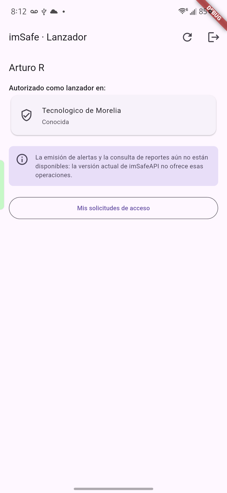

# Snapshot — imSafe Lanzadores · 2026-09-24

Estado actual de la app para retomar el trabajo. Fuente: repositorio local +
app instalada en el teléfono de pruebas (inspección de solo lectura vía `adb`).

## 1. Build instalada en el dispositivo

| Dato | Valor |
|---|---|
| Dispositivo | Samsung SM-S921U (Galaxy S24) · Android 16 (API 36) · `RFCX31S364V` |
| Paquete | `com.example.imsafe_lanzadores` (identificador provisional) |
| Versión | `1.0.0` (versionCode 1) · **debug** (`flutter run`) |
| minSdk / targetSdk | 24 / 36 |
| Instalada | 2026-09-23 21:01 (código Dart en el dispositivo: 21:01) |
| Último cambio en `lib/` | 2026-09-23 20:57 → **la build instalada corresponde al código actual** |
| Permisos Android | solo `INTERNET` |
| Flutter | 3.47.5 stable |

> Nota: `build/app/outputs/flutter-apk/app-debug.apk` (21:08) no es idéntico
> byte a byte al APK instalado (21:01); es un rebuild posterior sin cambios de
> código fuente.

## 2. Estado en ejecución (08:12)

- Pantalla activa: **Inicio del lanzador** (`/home`).
- Sesión guardada en `flutter_secure_storage` (claves
  `imsafe.session.accessToken` y `imsafe.session.refreshToken`; valores no leídos).
- Usuario: **Arturo R**.
- Autorizado como lanzador (`capabilities.launcher == true`) en
  **Tecnologico de Morelia** (subtítulo = `address` que devuelve la API: "Conocida").
- Aviso visible: la emisión de alertas y consulta de reportes no están
  disponibles porque imSafeAPI v0.2.0 no ofrece esas operaciones.
- Acciones visibles: *Actualizar estado*, *Cerrar sesión*, *Mis solicitudes de acceso*.

⚠️ Tecnologico de Morelia es una **institución real de producción**. Por la regla
de seguridad vigente, no crear/actualizar/finalizar alertas ni enviar solicitudes
de acceso sin un contexto de prueba controlado confirmado por el usuario.

## 3. Código

Arquitectura feature-first (AGENTS.md §5.1): Riverpod · Dio · go_router ·
flutter_secure_storage. 39 archivos Dart en `lib/` + `test/`.

- `lib/app/` — `app.dart`, `router.dart` (rutas `/loading`, `/error`, `/login`,
  `/register`, `/access`, `/home` con redirect por sesión y acceso),
  `status_screens.dart`, `theme/app_theme.dart`.
- `lib/core/` — `api/` (ApiClient Dio + AuthInterceptor con renovación
  serializada), `config/` (entornos vía `--dart-define`), `errors/`, `logging/`,
  `storage/` (secure storage + TokenStore), `utils/`.
- `lib/features/auth/` — login, registro, logout, `session_controller`.
- `lib/features/access/` — buscar institución y solicitar acceso, lista de
  solicitudes (`pending/approved/rejected/revoked`), inicio del lanzador.
- `lib/shared/widgets/` — `form_page`, `status_message`, `button_progress`.
- Contrato de API usado: [`docs/API_CONTRACT_LANZADORES.md`](../API_CONTRACT_LANZADORES.md).

## 4. Calidad (verificado 2026-09-24)

- `flutter analyze` → **No issues found**.
- `flutter test` → **52 pruebas, todas pasan** (router, api_client,
  auth_interceptor, app_config, failure_messages, app_logger, access_dtos, widget).
- `integration_api/real_api_test.dart` — pruebas contra la API real
  (solo login/lecturas/refresh/logout); se ejecutan manualmente con credenciales
  por `--dart-define`.

## 5. Git

Rama `main`, **sin commits**: todo el proyecto está sin rastrear (`??`).

## 6. Pendiente / siguiente paso

- **Bloqueado por imSafeAPI:** alertas, reportes, tipos de emergencia, áreas,
  idempotencia.
- **Decisiones abiertas (AGENTS.md §20):** reintentos/idempotencia de operaciones
  críticas, offline/caché, push para lanzadores, tokens de diseño finales
  (rojo/café/beige/neutros), identificador definitivo de la app
  (hoy `com.example.imsafe_lanzadores`).
- Sugerido: primer commit del estado actual.
